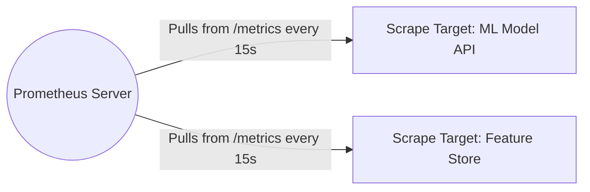

# Instructor Guide: Observability and Log Management

## Module Overview
In this module, instructors will guide students through the critical transition of moving an AI model into the deployment and monitoring phase, which requires robust oversight. Students will develop observability skills by learning how to instrument systems to emit metrics, logs, and traces. The session focuses heavily on practical application, culminating in a 60-minute hands-on lab using Prometheus and Grafana.

## Learning Objectives
By the end of this session, students will be able to:
* Identify the components of observability: metrics, logs, and traces.
* Use monitoring tools to collect and interpret system data.
* Critically evaluate observability dashboards to detect anomalies and improve transparency.

## Session Pacing Guide (120 Minutes total)

| Duration   | Segment                                     | Instructor Action                                                                                                                                                                                                                                                              |
|:-----------|:--------------------------------------------|:-------------------------------------------------------------------------------------------------------------------------------------------------------------------------------------------------------------------------------------------------------------------------------|
| **10 min** | **Introduction & Module Overview**          | Set the stage. Ask the class: *"When your model API returns a 500 Internal Server Error, how do you know if it's the Python code, the database, or the model itself?"*                                                                                                         |
| **25 min** | **The Three Pillars of Observability**      | Define Metrics, Logs, and Traces. Use the "Detective Analogy" to differentiate them. Explain Log levels (INFO, WARN, ERROR).                                                                                                                                                   |
| **25 min** | **Collecting Data & Evaluating Dashboards** | Live whiteboard the Prometheus pull architecture. Discuss why looking at "average" latency can be dangerously misleading, tying back to how understanding when metrics might be misleading is crucial for proper model evaluation. Explain Counters vs. Gauges vs. Histograms. |
| **60 min** | **Lab: Monitoring Dashboard Setup**         | Facilitate the hands-on lab. Help students connect Grafana to their local Prometheus container.                                                                                                                                                                                |

---

## Delivery Notes & Teaching Tips

### 1. The Three Pillars of Observability
* **The "Detective" Analogy:** Experienced professionals appreciate practical analogies. 
    * **Metrics** are the smoke alarm (tells you *something* is wrong immediately).
    * **Traces** are the security camera footage (shows you exactly *where* the intruder went across multiple rooms/services). 
    * **Logs** are the detailed police report (gives you the exact, verbose context of what happened at a specific moment).
* **AI Context:** Emphasize that in AI, logs must include prediction inputs and outputs (if compliance allows) to catch silent data drift later.

### 2. Collecting and Interpreting System Data
* **Pull vs. Push:**  Explain the architectural difference between Prometheus (which *pulls/scrapes* metrics) and traditional logging (which *pushes* data to a central server).   
* **Draw the Architecture:**
   Use the whiteboard to show how adding a new AI model simply requires exposing a `/metrics` endpoint. *Note: Ensure your arrows clearly denote Prometheus initiating the pull, not the application pushing.*  

### 3\. Evaluating Dashboards & Detecting Anomalies

  * **Concept Check:**  Revisit the idea that choosing the right evaluation metric depends on the business impact. Apply this to operational metrics.  
  * **Averages vs. Percentiles:**  Draw a highly skewed distribution graph on the board. Show how the "average" inference time might be 50ms, but the 99th percentile (p99) is 2000ms. Ask the room: *"Who are those 1% of users experiencing 2-second delays, and why?"* Connect this to why we use **Histograms** instead of **Gauges** for latency.  

-----

## Lab Guide: Monitoring Dashboard Setup

**Lab Objective:** Collect and visualise live metrics with Prometheus and Grafana. This hands-on lab builds foundational skills in monitoring system performance and detecting anomalies.

### Setup

  * Ensure Docker Desktop is running.
  * Ensure students have accessed the lab directory containing the `docker-compose.yml` (for the Prometheus, Grafana, and mock ML API images) and the instrumented `app.py`.

### Common Student Issues & Solutions

| Issue                                                           | Root Cause                                                                                         | Instructor Solution                                                                                                                                            |
|-----------------------------------------------------------------|----------------------------------------------------------------------------------------------------|----------------------------------------------------------------------------------------------------------------------------------------------------------------|
| **"Grafana cannot connect to Prometheus."**                     | Students often type `http://localhost:9090` as the data source URL inside Grafana.                 | In a Docker network, containers must route by service name. Tell them to use `http://prometheus:9090` instead.                                                 |
| **"My Prometheus targets are showing as DOWN."**                | The ML API container crashed, or the `prometheus.yml` scrape config has a typo in the target port. | Have them run `docker-compose logs ml-api` to check for app crashes, or inspect the YAML file indentation.                                                     |
| **"The AI gave me a PromQL query that throws a syntax error."** | AI hallucinations regarding specific PromQL syntax or metric names.                                | If the AI gives a complex or weird answer, teach students to cross-reference. Suggest they use Grafana's visual query builder first before writing raw PromQL. |

### Debrief Questions

At the end of the lab, ask:

1.  "If we deploy a new version of the model and CPU usage spikes by 400%, but prediction latency remains flat, what is our next troubleshooting step?"
2.  "Why is it important to have observability dashboards visible to both the ML engineers and the business stakeholders?"

-----

## Resources for the Instructor

  * **References:** 
    * [Site Reliability Engineering Book - Monitoring Distributed Systems](https://sre.google/sre-book/monitoring-distributed-systems/)
    * [Grafana Best Practices for Dashboards](https://grafana.com/docs/grafana/latest/dashboards/build-dashboards/best-practices/)
  * **AI Prompt Bank:** Keep these handy to share with students who are stuck:
      * *"What is the difference between a Prometheus Gauge and a Counter? Give an example of each for an AI inference API."*
      * *"Write a PromQL query to calculate the error rate (HTTP 500s / Total Requests) over the last 5 minutes."